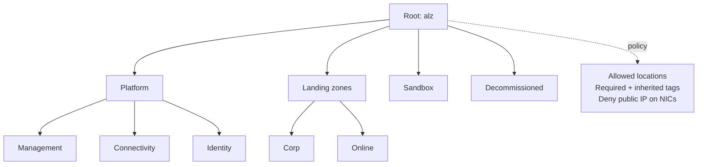
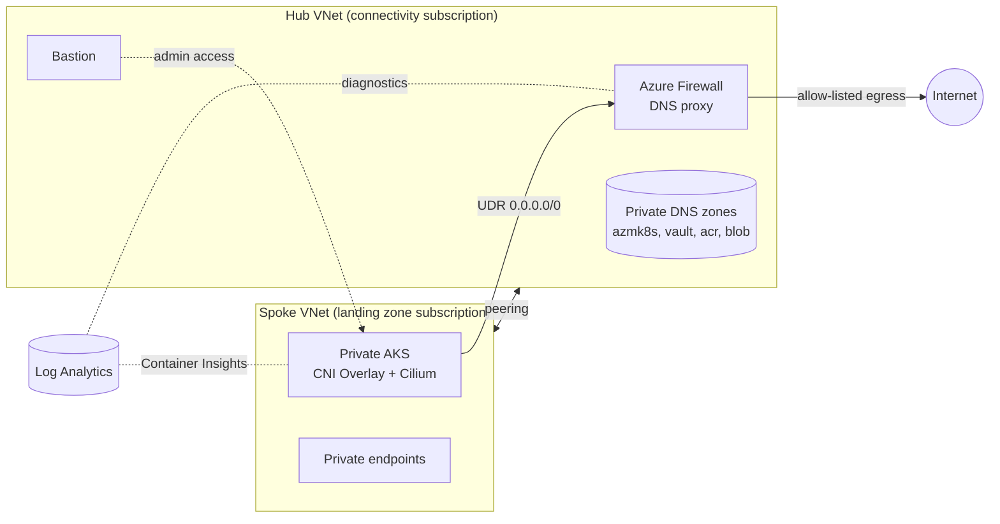
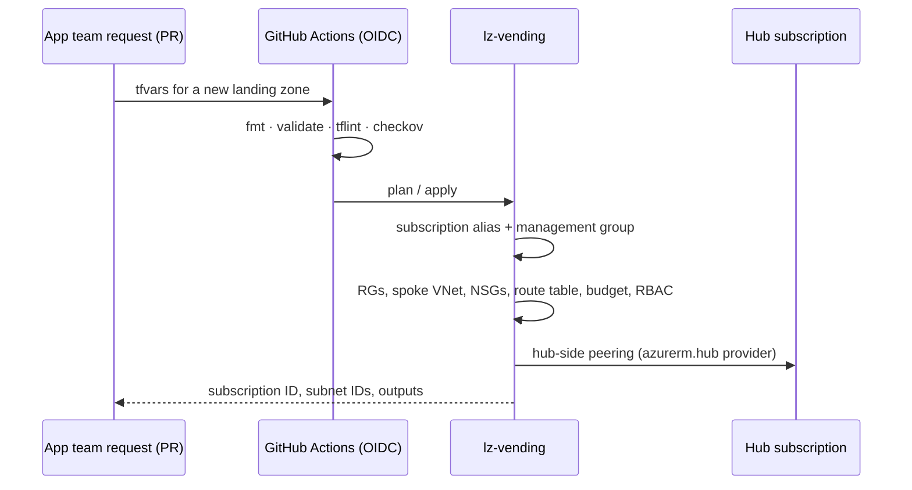

# Azure Landing Zone (Terraform)

[](https://github.com/rakshith-ponnappa/azure-landing-zone-terraform/actions/workflows/ci.yml)


[](LICENSE)

An **opinionated, CAF-aligned Azure landing zone in Terraform**: management groups and policy,
hub-spoke connectivity, subscription vending and a private AKS spoke, with policy-as-code checks in CI.

It distils the patterns I use when building enterprise Azure platforms into small modules you can
read in one sitting. Every name, ID and address in this repo is a placeholder.

## What you get

| Module | Purpose |
|---|---|
| [`governance`](modules/governance) | Management-group hierarchy (platform, landing zones, sandbox, decommissioned) and built-in policies: allowed locations, required and inherited tags, no public IPs on NICs |
| [`management`](modules/management) | Central Log Analytics (optional Automation account) and a diagnostic-settings helper |
| [`connectivity`](modules/connectivity) | Hub VNet, Azure Firewall (with an AKS egress rule set), Bastion, central private DNS zones, hub-side peering |
| [`lz-vending`](modules/lz-vending) | Application landing zone: subscription (optional alias), placement, resource groups, spoke VNet and NSGs, route table to the firewall, hub peering, budget, app-team RBAC |
| [`aks-spoke`](modules/aks-spoke) | Private AKS: CNI Overlay with Cilium, egress through the firewall, Entra ID-only access, workload identity, Azure Policy add-on, Container Insights |
| [`identity`](modules/identity) | RBAC and a user-assigned identity with federated credentials (GitHub Actions OIDC, no secrets) |
| [`naming`](modules/naming) / [`tagging`](modules/tagging) | CAF naming convention and the mandatory tag set |

## Architecture

### Management groups



### Hub-spoke network



### Subscription vending



## Quickstart

Prerequisites: Terraform 1.6 or newer, Azure CLI, and rights to create management groups and policy
assignments at the tenant root (for `governance`).

```sh
git clone https://github.com/rakshith-ponnappa/azure-landing-zone-terraform.git
cd azure-landing-zone-terraform/examples/platform
cp terraform.tfvars.example terraform.tfvars   # fill in your subscription IDs
cp backend.tf.example backend.tf               # remote state (optional for a trial)
az login
terraform init && terraform plan
```

Deploy in this order:

1. **`examples/platform`**: governance, management, hub connectivity and the deploy identity.
2. **`examples/landing-zone-aks`**: one stack per application landing zone. It takes the platform
   outputs (hub VNet ID, firewall IP, private DNS zone ID, workspace ID) as inputs.

## Design decisions

- **Hub-spoke rather than Virtual WAN.** It gives explicit control over firewall, DNS and routing,
  is cheaper for a handful of regions, and is easier to reason about. vWAN is on the roadmap for
  large multi-region estates.
- **Vending as a module, not a portal process.** A landing zone is a pull request with a tfvars
  file. Guardrails (no Owner for app teams, route to firewall, budget) are code, not checklists.
- **Two providers for peering.** `lz-vending` declares `azurerm.hub`, so the spoke stack creates both
  sides of the peering without ever being given Contributor on the hub.
- **Private AKS with Overlay networking.** Pods don't consume VNet addresses, so spokes stay /22-sized.
  Egress goes through the firewall by UDR, and local accounts are disabled (Entra ID + Azure RBAC only).
- **Built-in policies first.** Built-in definitions need no maintenance; custom ones are added only
  when no built-in fits.
- **Validation in variables.** Inputs fail at `plan` with a clear message (CIDRs, SKUs, reserved
  subnet names, privileged roles) instead of failing halfway through an `apply`.

## Security baseline

- No secrets in code or pipelines: GitHub Actions authenticates with **OIDC federated credentials**.
- No public IPs on NICs (policy), a private AKS API server, Bastion for admin access, and firewall
  egress with threat intelligence set to Deny.
- Central diagnostics to Log Analytics for the firewall, hub and AKS control plane (`kube-audit-admin`).
- Remote state in a storage account with Entra ID auth (`use_azuread_auth = true`) and shared keys disabled.
- App-team RBAC rejects Owner, User Access Administrator and RBAC Administrator.

## CI

[`ci.yml`](.github/workflows/ci.yml) runs on every push and pull request:

| Job | What it checks |
|---|---|
| fmt | `terraform fmt -check -recursive` |
| validate | `terraform init -backend=false` and `terraform validate` for each example |
| tflint | Terraform and azurerm lint rules |
| checkov | Policy-as-code security scan (soft-fail, results in the job summary) |

A commented-out `plan` job shows the OIDC login (`azure/login` with `client-id`, `tenant-id` and
`subscription-id`) for wiring the repo to a real tenant.

## Repository layout

```text
modules/        naming, tagging, management, connectivity, governance, identity, lz-vending, aks-spoke
examples/       platform (deploy first) and landing-zone-aks (one per application)
.github/        CI workflow
```

## Roadmap

- [ ] Option to swap modules for [Azure Verified Modules](https://azure.github.io/Azure-Verified-Modules/)
- [ ] Virtual WAN connectivity option
- [ ] Defender for Cloud plans and a Microsoft Sentinel workspace option
- [ ] Policy initiative for AKS (pod security baseline, allowed registries)
- [ ] Terratest or `terraform test` suites for the modules

## Acknowledgements

Patterns informed by the [Microsoft Cloud Adoption Framework](https://learn.microsoft.com/azure/cloud-adoption-framework/ready/landing-zone/)
and [Azure Verified Modules](https://azure.github.io/Azure-Verified-Modules/).

## License

[MIT](LICENSE)
